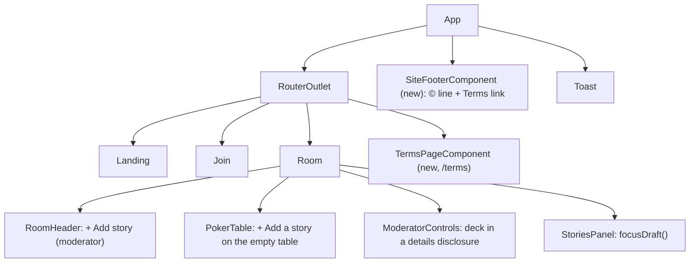
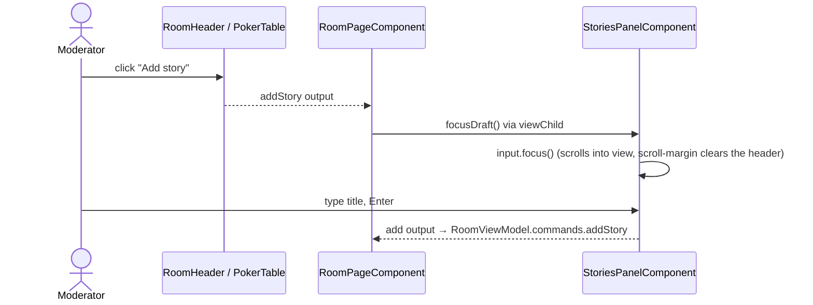

# 02 · Design — Room polish and legal

## Component tree

## Sequence diagram

The jump is view-only (focus), so it stays in the component layer; the view model is unchanged.

## Data model and rules

No change. The terms page is static; the copyright text lives in `shared/constants/legal.constants.ts`.

## ADRs raised

None. Using the native `
` element for the deck keeps the open state out of the view
model and gives keyboard and screen-reader support for free.
