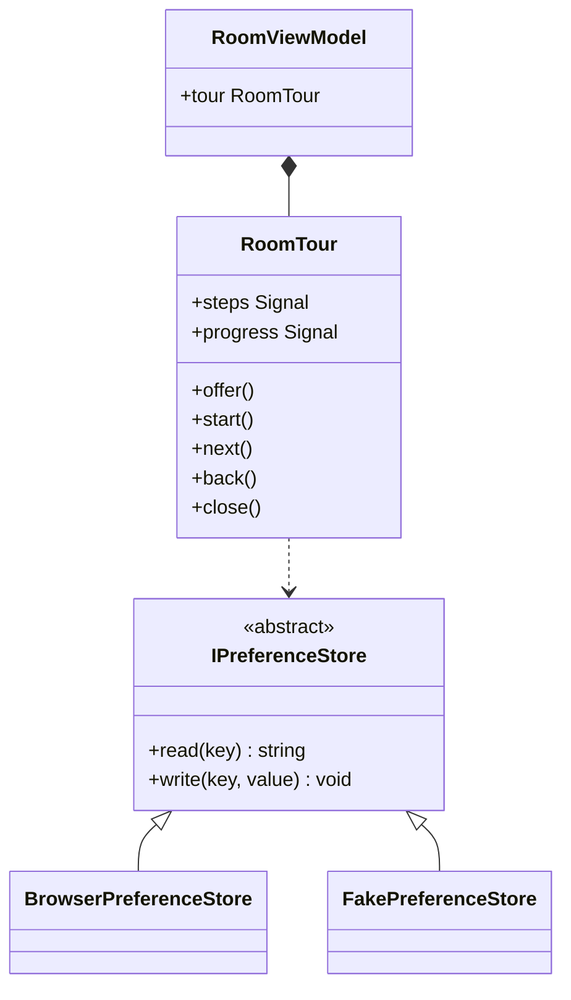
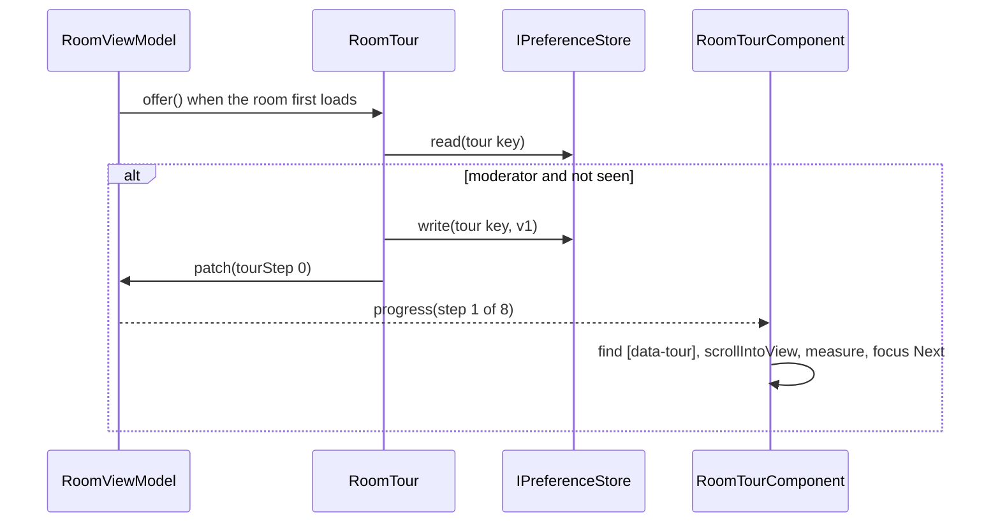

# 02 · Design — Room tour

## Component tree

`RoomPageComponent` renders `RoomTourComponent` while `model.tour.progress()` is not `null`. The
parts it points at carry a `data-tour` attribute (`TourTarget` enum): the header's Invite, Add story
and "?" buttons, the poker table, the card deck, the moderator controls, the people and stories
panels.

## Class diagram

## Sequence diagram

## Data model and rules

No Firestore change. One `localStorage` key: `planning-poker.room-tour = v1` (bump the value to show
a changed tour again).

## ADRs raised

None: a new port follows ADR-0002. The tour state lives in the room view model's state
(`tourStep`), so the page still has one subscription.
