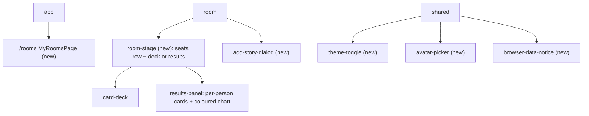

# 02 · Design — Rooms, themes and avatars

## Theme

`t.color(name)` returns `var(--pp-name)`. `styles/_theme.scss` defines the light values on `:root`
and the dark values for `[data-theme='dark']` and for `prefers-color-scheme: dark` unless the page
is forced light. `ThemeService` (shared) keeps the choice (`system`, `light`, `dark`) in
`IPreferenceStore` and sets `data-theme` on `<html>`; a tiny script in `index.html` applies it
before the app boots, so there's no flash.

## Room

The page's main column becomes: story header → stage. The stage shows, while voting, the seats as
a row of avatars with a voted tick and the deck as large cards; after the flip, the results:
average, median, agreement, each person's card coloured by band, and the distribution bars in the
same colours. Bands: the deck's numeric cards split in thirds (`scoreBand(deck, card)`); `?` and
the break card are grey.

## Data and rules

- `participants/{uid}.avatar`: optional string, one of the 16 animal ids.
- Facilitator: the moderator's seat is created with `role: 'spectator'`; no rules change needed.
- My rooms: `IPreferenceStore` keeps `planning-poker.profile` (name, avatar) and
  `planning-poker.rooms` (id, name, code, role, last visit) as JSON.
- CSV: read the room's stories, rounds (with `storyId`) and each revealed round's votes; for each
  story, the last revealed round's votes, one column per participant.

## Component tree (new and changed)

