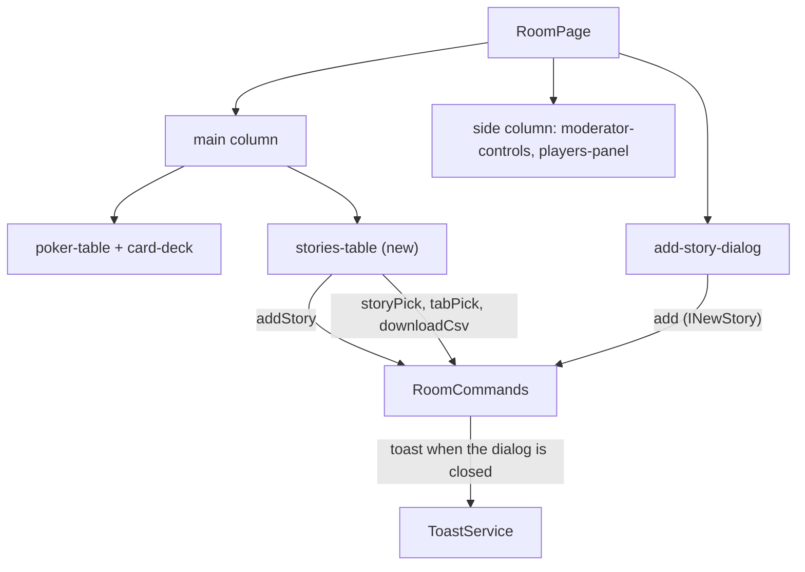

# 02 · Design — Stories table

- `StoriesTableComponent` replaces `StoriesPanelComponent`: a semantic `<table>` with a header
  bar (title and count, tabs, CSV, Add story). Inputs are unchanged (`stories`, `counts`, `tab`,
  `activeId`, `isModerator`); new output `addStory`.
- `storyRows(stories, activeId)` (pure, `models/story-row.ts`) gives each row its
  `StoryRowStatus` (voting, open, estimated, skipped), label and the moderator's action
  (`Vote`, `Re-estimate`, or none for the story being voted on).
- `AddStoryDialogComponent` keeps `added: string[]` for the stories sent with "Add another" and
  shows them in a `role="status"` panel under the buttons. A red `btn--danger` Close button
  joins the corner ×.
- `RoomCommands.addStory` shows "Story added: <title>" once the write lands, only when the
  dialog is closed.
- New tokens: `success-wash`, `danger`, `danger-hover`, `$shadow-raised`.
