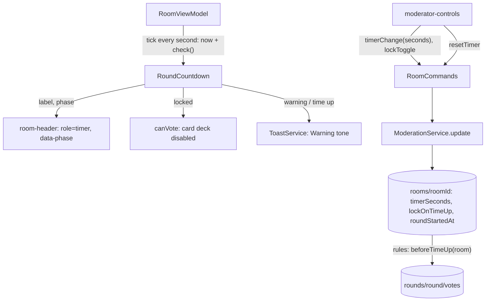
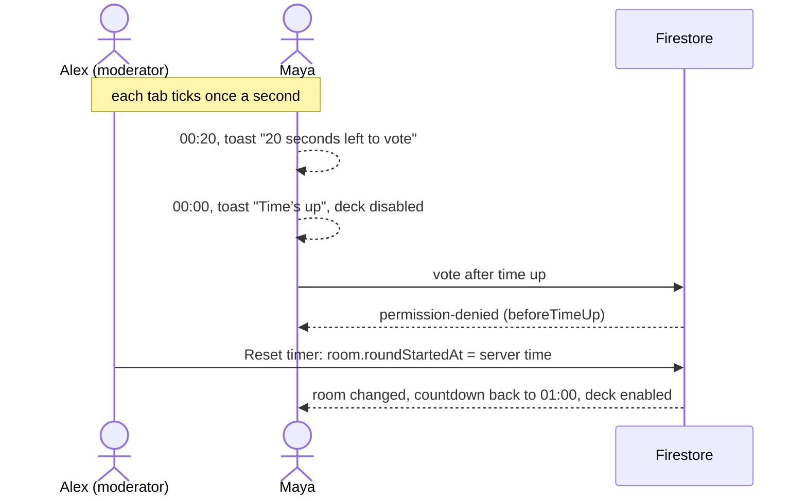

# 02 · Design — Round countdown

- **Data:** the room gains `timerSeconds` (int 30–600, default 60) and `lockOnTimeUp` (bool,
  default true). The deadline is `roundStartedAt + timerSeconds`. "Reset timer" sets
  `roundStartedAt` to the server time, as it did before.
- **Model:** `Room.secondsLeft(now)` (rounded up, between 0 and the length) and
  `Room.isVotingLocked(now)`.
- **`RoundCountdown`** (view-model helper, `view-models/round-countdown.ts`): `secondsLeft`,
  `label`, `running` (a story is active and the cards aren't flipped), `phase` (`TimerPhase`:
  idle, running, warning, up) and `locked`. `check()` runs on every tick and toasts only on a
  crossing seen between two ticks of the same round (keyed by round and start time).
- **UI:** the header timer reads "Time left" and takes `timerPhase` for its colour. Moderator
  controls gain a Countdown stepper (−/+ 30 s, disabled at the limits) and a "Lock voting at
  time up" switch; "Reset timer" turns red while voting is locked.
- **Rules:** `validTimer()` on create and update; `beforeTimeUp(room)` joins `roundIsOpen()`, so
  votes are refused after the deadline plus 2 seconds while the lock is on.
- **Tokens:** `warning-wash`, `warning-text`, `danger-wash`, `danger-text` (light and dark).
- **Toasts:** a new `ToastTone.Warning`; the toast sets `data-tone` for its icon colour.

