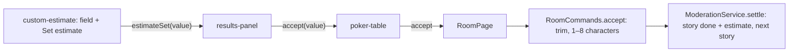

# 02 · Design — Manual estimate

- `CustomEstimateComponent` (`features/room/components/custom-estimate`): a typed reactive form
  with `TextValidators.notBlank` and `maxTrimmed(LIMITS.estimate)`; emits the trimmed value and
  clears. Its own component because the results panel's styles are at their budget.
- `LIMITS.estimate = 8` mirrors `isText(data.estimate, 1, 8)` in `firestore.rules`.
- `RoomCommands.accept` trims and ignores a blank or too-long value, then settles as before, so
  the same path serves the suggested card, the alternatives and a typed value.
