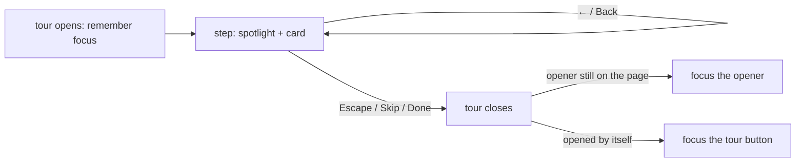

# 02 · Design — Accessibility pass and a better room tour

- **Cards:** named by their content, a visually hidden "Vote " plus the value, instead of an
  `aria-label`, so the visible value is in the name (WCAG 2.5.3). The break card, an icon only,
  keeps its label.
- **Headings and landmarks:** a visually hidden `h1` with the room name when no story is active;
  the landing page's footer links sit in a labelled region.
- **Tour component:** arrow keys (ignored while typing in a field), `aria-keyshortcuts` on Back
  and Next, a polite live region around the title and text, progress dots (hidden from screen
  readers: "Step 3 of 10" says it), and focus handed back on destroy.
- **Tour content:** new steps "The countdown" (the header timer, everyone) and "Settle the
  estimate" (the table, moderator); "Your cards", "The table", "Run the round" and the last step
  updated. Ten steps for the moderator, seven for players.
- **Countdown label:** shows the full length while no round runs (no story, or flipped).
- **e2e:** `axeFor(page)` in `e2e/fixtures/test.ts` holds the tag set for every scan.
