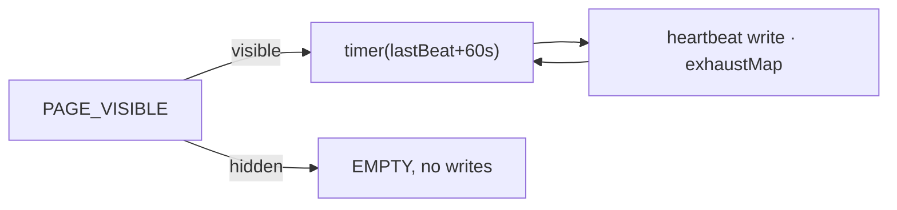

# 02 · Design — Performance hardening and a security audit

## Heartbeat (presence)

- `HEARTBEAT_INTERVAL_MS` 30 s → 60 s, `ONLINE_WINDOW_MS` 75 s → 150 s (two missed beats and a
  margin, as before).
- A new port-level token `PAGE_VISIBLE` (`core/tokens/page-visible.token.ts`) is an
  `Observable<boolean>`: `true` now and whenever the tab returns, `false` while it is hidden
  (`document.visibilityState`). It is a token, not a direct `document` read in the view model, so
  the model stays testable (D in SOLID) and nothing outside backends/tokens touches the DOM.
- `RoomViewModel.heartbeat()` switches on `PAGE_VISIBLE`: while visible it beats on a 60 s timer
  measured from the last beat, while hidden it is silent. Coming back beats at once only if the
  minute has already passed, so flipping between tabs never adds writes. `exhaustMap` still keeps
  a slow write from stacking.

## Font fallback (layout shift)

- `styles/_fonts.scss`: `@font-face` fallbacks `Inter Fallback` and `Space Grotesk Fallback`,
  each `local('Arial'/'Arimo')` with `size-adjust`, `ascent-override` and `descent-override`
  measured in Chrome (canvas `measureText`, as Capsize / next/font do). Weight ranges split so the
  bold fallback uses Arial Bold.
- The token font stacks name the fallback right after the web font:
  `'Space Grotesk', 'Space Grotesk Fallback', system-ui, …`. The swap no longer changes metrics.

## Footer (layout shift)

- The footer is hidden until the routed page exists: `router-outlet + app-site-footer { display: none }`
  in `styles/_base.scss`. The router inserts the page between the outlet and the footer, so from
  the first render the footer sits below the page instead of starting at the top and being pushed
  down. No new component state.

## Caching

- `public/staticwebapp.config.json` adds `immutable`, one-year `cache-control` for `main-*`,
  `chunk-*`, `styles-*`, `polyfills-*` and `media/*` (all content-hashed by `outputHashing: all`).
  `index.html` and `runtime-config.js` keep their short/no-cache headers.

## Security

- No new code design: the audit reviews `firestore.rules`, `app.config.ts` CSP, the Azure
  Functions in `api/`, the token/secret handling and the client/rules input limits, then fixes
  land as small, tested changes. See [`04-verification.md`](04-verification.md).
