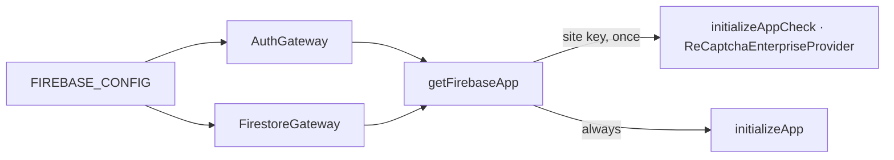

# 02 · Design — App Check (reCAPTCHA Enterprise)

See [ADR-0012](../../architecture/adr/0012-app-check-recaptcha.md) for the decision.

- **Config:** `IFirebaseConfig` gains optional `appCheckSiteKey`. It flows through the existing
  `FIREBASE_CONFIG` token and the gateway loaders to the gateway constructors — no new token.
- **One init point:** a new `core/backends/firebase/firebase-app.ts` exports `getFirebaseApp(config)`.
  Both gateways call it instead of `initializeApp`, so `initializeApp` now lives in one place.
  The first call with a site key starts App Check on the app; a `WeakSet<FirebaseApp>` stops the
  second gateway starting it again.

