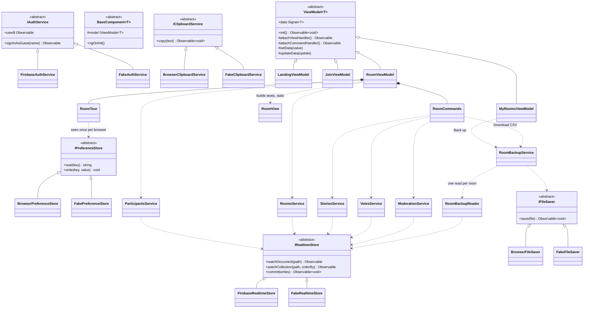

# Class diagram

- `RoomViewModel` combines the live streams into one `IRoomState`; `RoomView` turns that state into
  seats, players, results and the next story with pure functions.
- `RoomCommands` runs every user action through one `concatMap` queue, so writes keep their order,
  and re-checks the moderator role when the action runs.
