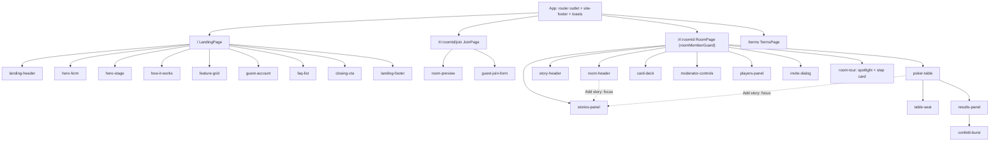

# Component tree

Shared building blocks: `logo`, `icon`, `avatar`, `toast`, `site-footer` (copyright and terms link), and the style directives
`appDelay`, `appWidthPercent` and `appBackground` (templates never bind styles directly).
