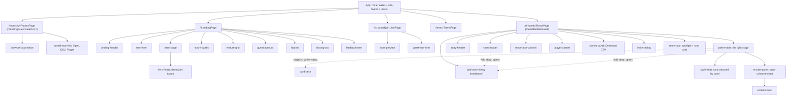

# Component tree

Shared building blocks: `logo`, `icon`, `avatar` (an animal face, or initials for older seats),
`avatar-picker` (on the create and join forms), `toast`, `site-footer` (copyright and terms link),
`theme-toggle` (in every page header: system, light, dark), `appModal` (opens a native `<dialog>`
from state, used by both room dialogs), and the style directives
`appDelay`, `appWidthPercent` and `appBackground` (templates never bind styles directly).
