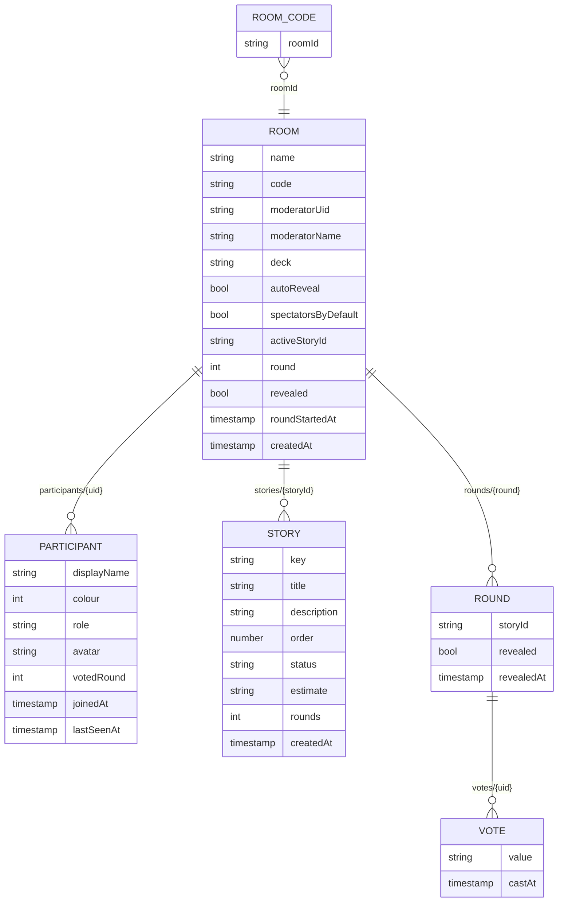

# Data model

All documents live in Cloud Firestore. Ids are strings; times are server timestamps written with
the `SERVER_TIME` sentinel. `firestore.rules` checks every write's shape, sizes and enum values,
and `tests/rules` covers each allow and deny.

## Documents

| Path                                        | Fields and limits                                                                                                                                                                     |
| ------------------------------------------- | ------------------------------------------------------------------------------------------------------------------------------------------------------------------------------------- |
| `rooms/{roomId}`                            | `roomId` = slug of the name + 6 random characters. `name` 1–60, `moderatorName` 1–40, `deck` one of `mfib`, `fib`, `tshirt`, `pow2`; `round` starts at 1                              |
| `roomCodes/{code}`                          | `{ roomId }`. Code `XXXX-XX` from `ABCDEFGHJKMNPQRSTUVWXYZ23456789` (no 0, O, 1, I, L)                                                                                                |
| `rooms/{roomId}/participants/{uid}`         | `displayName` 1–40, `colour` 0–5, `role` `player` or `spectator`, `avatar` one of the 16 animal ids (optional: older seats have none), `votedRound` = the round you voted in, or null |
| `rooms/{roomId}/stories/{storyId}`          | `key` 1–16, `title` 1–200, `description` ≤ 2000, `status` `pending`, `done` or `skipped`, `estimate` a card or null                                                                   |
| `rooms/{roomId}/rounds/{round}`             | Created by the moderator at the flip. Its existence unlocks the round's votes                                                                                                         |
| `rooms/{roomId}/rounds/{round}/votes/{uid}` | `value` one card of the room's deck, `castAt`                                                                                                                                         |

A new round is `round + 1`: nothing is deleted, and old rounds stay for the later summary.

## Who may do what

| Document    | Read                                                       | Write                                                                                                                                                           |
| ----------- | ---------------------------------------------------------- | --------------------------------------------------------------------------------------------------------------------------------------------------------------- |
| room        | `get` by anyone signed in; never `list`                    | create as its moderator, with its code and own seat in the same batch; update by the moderator: the round moves by exactly one, the flip needs its round marker |
| roomCode    | `get` by anyone signed in; never `list`                    | create only with its room; never changed                                                                                                                        |
| participant | anyone signed in (the join page shows who is in)           | your own seat; `votedRound` only to the room's current round; the moderator may change `role` and remove people                                                 |
| story       | participants                                               | the moderator                                                                                                                                                   |
| round       | participants                                               | the moderator, for the current round, together with `revealed: true` on the room                                                                                |
| vote        | your own always; others' only once the round marker exists | your own, as a player, while the round is open, with a card of the deck, marking your seat in the same batch                                                    |

So nobody can read another person's card before the flip, even with dev tools (ADR-0008).
