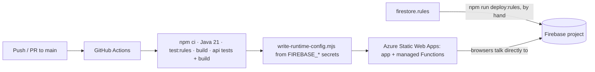

# Deployment

Nothing in this document is created or deployed without the owner's explicit OK.

| Environment | Backend                      | How to run                                     |
| ----------- | ---------------------------- | ---------------------------------------------- |
| Local       | Fake (in memory)             | `npm start`                                    |
| Emulator    | Firestore + Auth emulators, project `demo-planning-poker` | `npm run emulators`, then `npm run start:emulator` |
| Live (local) | The real Firebase project, alias `live`, config from `public/runtime-config.js` | `npm run start:live` |
| Production  | The real Firebase project    | Azure Static Web Apps, config from GitHub secrets |

- `public/staticwebapp.config.json` falls back to `/index.html`, so `/r/<id>` links work, and serves
  `runtime-config.js` without caching.
- The Firebase web config is never committed: CI writes `runtime-config.js` from the `FIREBASE_*`
  secrets; locally copy `public/runtime-config.example.js`.
- The workflow needs the Static Web Apps deployment token secret, so it only runs once the Azure
  resource exists.
- Before going live: deploy the rules, turn on Anonymous sign-in, add the site's domain to Auth's
  authorised domains, and consider App Check.
