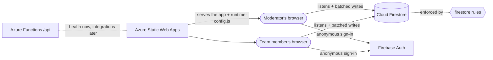
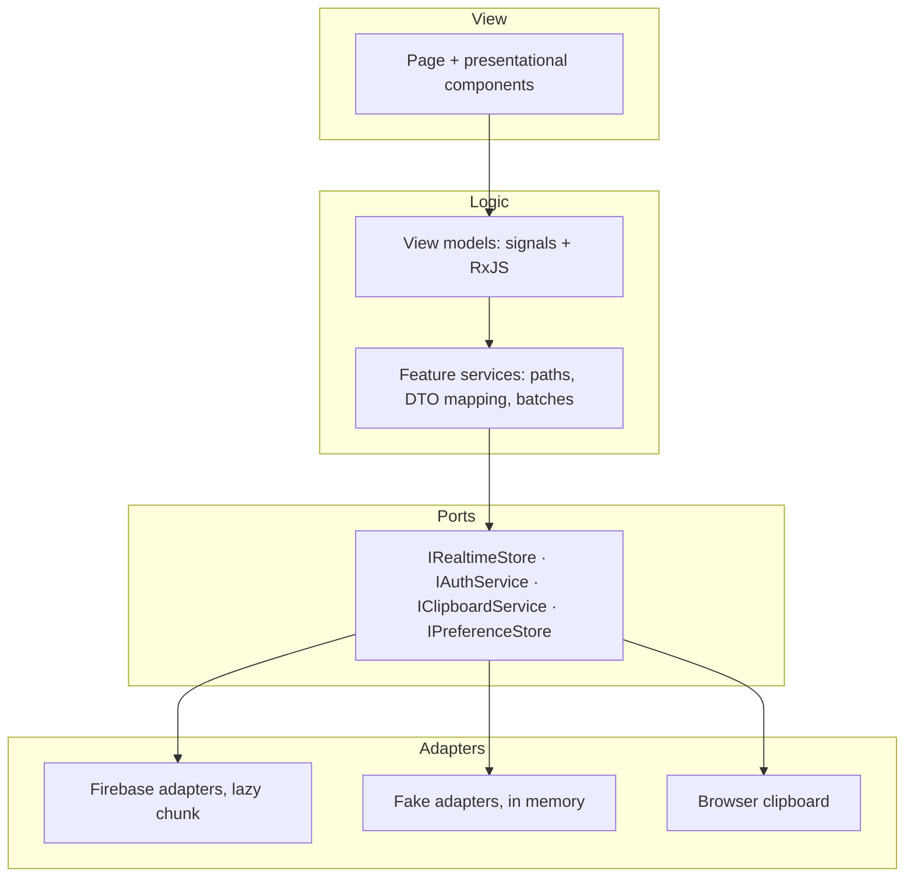

# Architecture overview

PlanningPoker is a single-page Angular app. Everyone in a room listens to the same few Firestore
documents, so a vote, a flip or a new story appears in every browser within a moment. There is no
app server in the loop: Firestore's security rules are the server-side authority.

## System context

## Layers

- Dependencies point one way: `features → shared → core/interfaces`. Only `core/backends`
  imports `firebase/*`, and only the factories reference `core/backends`.
- `APP_ENVIRONMENT.backend` picks Fake (`npm start`, unit tests, the Fake e2e suite) or Firebase
  (emulator and production builds).
- The Firebase SDK is loaded on demand through gateway loader tokens, so the landing page stays
  small.

## Features

| Feature    | Route             | What it does                                                          |
| ---------- | ----------------- | --------------------------------------------------------------------- |
| `landing`  | `/`               | Marketing page; create a room as a guest, or join by code             |
| `my-rooms` | `/rooms`          | The rooms this browser has been in: open, forget; browser-data notice |
| `join`     | `/r/:roomId/join` | Name, colour and role for someone opening a room link                 |
| `room`     | `/r/:roomId`      | The table: stories, votes, the flip, results, moderator controls      |
| `legal`    | `/terms`          | Terms of use: copyright, no account needed, data, warranty            |

`roomMemberGuard` sends anyone who is not yet in the room from `/r/:roomId` to the join form, so
the one link works for everybody. `returningGuestGuard` sends a guest who arrives at `/` with rooms
saved in this browser to `/rooms`; links inside the app still reach the home page.

The guest's name, avatar and room list live in this browser (`IPreferenceStore`, keys
`planning-poker.profile` and `planning-poker.rooms`), through `LocalProfileService` and
`MyRoomsService`. Clearing browser data empties them; the rooms stay in Firestore.

## Known limitations

- **Auto-reveal runs in the moderator's tab** (rules can't count votes). If the moderator's tab is
  closed, the round waits until the moderator returns or flips by hand.
- Presence is a heartbeat (`lastSeenAt` every 30 s, online within 75 s), not a live connection.
- Discussion threads, the session summary and accounts are later features.
